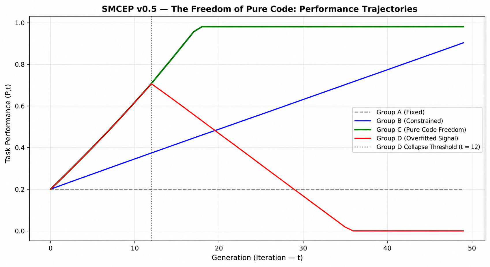

# SMCEP v0.5 — Deterministic Equation-Based Simulation

This repository contains the Python implementation of the historical **SMCEP v0.5 deterministic simulation** associated with the research manuscript:

**The Freedom of Pure Code: Formulating the Self-Modification Capability Emergence Problem (SMCEP)**

The simulation illustrates how different assumptions about modifiability, modification authority, and evaluation reliability can produce divergent task-performance trajectories over 50 generations.

**Important:** This is a deterministic, equation-based illustration, not an empirical experiment involving large language models. Its trajectories do not establish inevitable recursive self-improvement or inevitable performance collapse.

## Overview

The Self-Modification Capability Emergence Problem (SMCEP) distinguishes between an agent's task performance, \(P_t\), and its capacity to develop subsequent improvements, \(C_t\).

The historical v0.5 model considers four illustrative configurations:

| Group | Configuration | Illustrative trajectory |
|---|---|---|
| A | Fixed | Constant task performance |
| B | Constrained | Gradual performance improvement |
| C | Pure Code Freedom | Rapid improvement followed by saturation |
| D | Overfitted Signal | Initial improvement followed by a prescribed collapse |

All trajectories are generated by predefined update rules. In particular, Group D's collapse is a model assumption rather than an independently observed consequence of unreliable evaluation.

## Performance Trajectories



The figure illustrates the four task-performance trajectories over 50 generations. The vertical dotted line at generation 12 marks the predefined transition point for Group D.

## Repository Contents

| File | Description |
|---|---|
| `simulation.py` | Main Python simulation script |
| `pip install numpy pandas matplotlib` |
| `smcep_full_results.csv` | Simulation trajectory data |
| `smcep_historical_trajectory.png` | Performance trajectory visualization |

## Requirements

Python 3.8 or later is recommended.

The simulation uses the following Python packages:

- NumPy
- pandas
- Matplotlib

Install them using:

```bash
pip install numpy pandas matplotlib
```

## How to Run

Clone the repository:

```bash
git clone https://github.com/ahmett76/SMCEP-Simulation.git
cd SMCEP-Simulation
```

Run the simulation:

```bash
python simulation.py
```

## Expected Outputs

The simulation is intended to:

1. Print a summary of task performance at selected generations.
2. Export the simulated trajectory data to `smcep_full_results.csv`.
3. Generate a performance trajectory visualization.

The existing repository visualization is named `smcep_historical_trajectory.png`. Depending on the current version of `simulation.py`, a newly generated plot may instead be saved as `smcep_trajectory.png`.

## Scientific Interpretation and Limitations

The historical SMCEP v0.5 model is intended to illustrate conceptual possibilities, not to estimate real-world causal effects.

Its principal limitations are:

- The update equations and group configurations are predefined.
- The trajectories are deterministic rather than estimates from repeated stochastic experiments.
- Broader modification permissions do not necessarily imply greater development capacity.
- The prescribed collapse in Group D is not empirical evidence of inevitable failure caused by evaluation noise.
- Task-performance trajectories are not direct measurements of independently validated future development capacity.
- The simulation does not demonstrate recursive self-improvement in real AI systems.

The manuscript's later exploratory synthetic pilots (v0.6–v1.0) employ different experimental designs and measurement procedures. Their results should not be conflated with this historical illustration.

## Relationship to the Research Manuscript

This repository supports:

**Appendix D — Historical Illustrative Model and Its Limitations**

in the manuscript *The Freedom of Pure Code: Formulating the Self-Modification Capability Emergence Problem (SMCEP)*.

The broader research framework distinguishes six constructs:

- **M — Modifiability**
- **A — Modification Authority**
- **R — Resource Availability**
- **D — Candidate-Development Capability**
- **E — Evaluation Reliability**
- **F — Me
